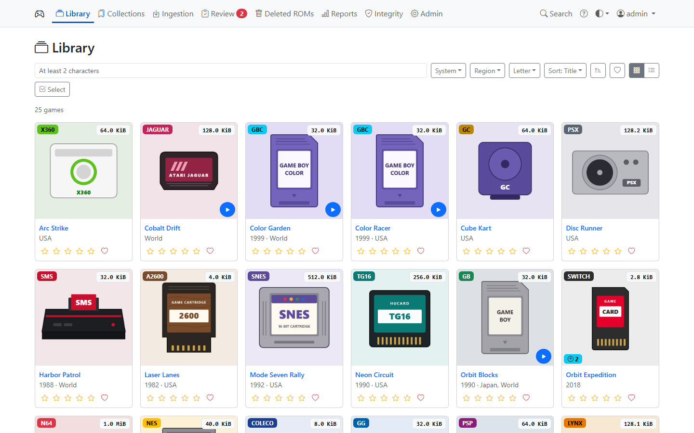
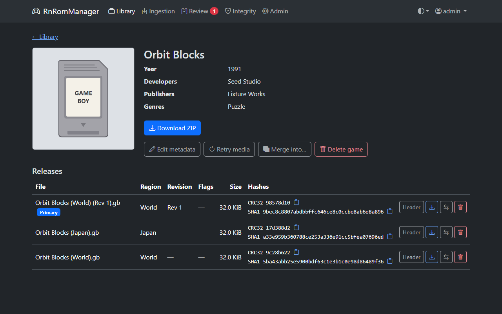
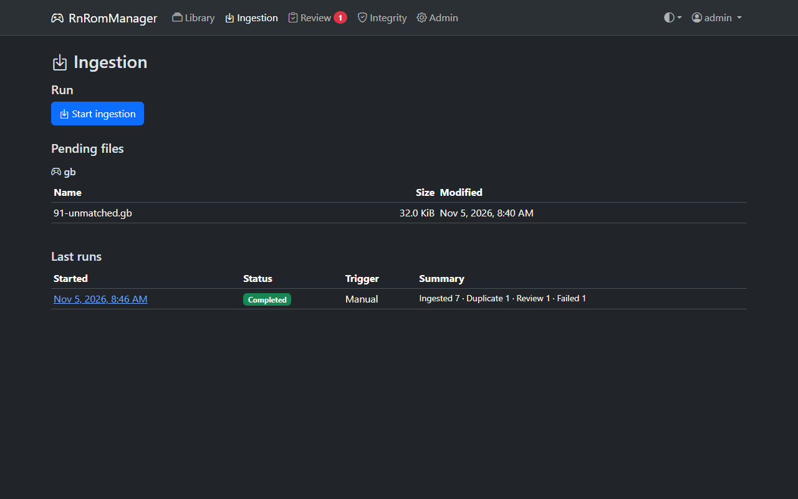

# RnRomManager

A self-hosted web app for managing a personal backup collection of ROMs across [supported systems](#supported-systems). Switch dumps, Nintendo 3DS dumps and disc images are stored as files next to each game's ZIP, since they're too large to pack; Nintendo DS dumps are stored next to the ZIP by default, and an Admin can move them inside it instead (Admin → ROM Zip Config); a PlayStation, Saturn, Sega CD, 3DO, TurboGrafx-CD or PC-FX bin/cue set, cdrdao TOC set (`.toc` and its `.bin` tracks), CloneCD rip (`.ccd`, `.img`, `.sub`) or Alcohol 120% rip (`.mds`, `.mdf`) is kept together as one release. PlayStation, Saturn, Sega CD, 3DO, TurboGrafx-CD and PC-FX also take MAME `.chd` images, which never match the Redump DAT and always go to Review.

Drop your own ROM files (or `.zip`/`.7z` archives of them) into an ingest folder. RnRomManager identifies each one against the [No-Intro](https://no-intro.org/) DATs (cartridge systems) or the [Redump](http://redump.org/) DATs (disc systems), names it consistently, groups every region and revision of a game together (MS-DOS games, which have no DAT, are one `.zip`/`.dosz` per game, aren't unpacked, and each goes to the Review queue to be named; arcade romsets are one `.zip` per set, identified by set name and the CRCs inside it against the MAME 2003-Plus DAT, and stored unchanged; FinalBurn Neo sets likewise, one `.zip` or `.7z` per set, against the FBNeo arcade DAT), fetches box art and screenshots, and stores each game as one self-describing ZIP in a tidy `roms/<system>/<letter>/` layout. A MariaDB database mirrors the library for fast browsing, and a scheduled integrity checker keeps the two in sync.



- **Library:** grid or list, filter by system, region and letter, search, sort by title, year or date added; primary ROM sizes; download a game's ZIP or a single ROM.
- **Collections:** private groups of games from any system with a cover and Markdown notes, filled from a game's page, the collection's page or a bulk selection in the Library, and found by the global search. **Publishers** and **Genres** tabs browse the whole library by metadata across systems, with shareable links and logos for publishers, genres and systems (starter art, an Admin-set image or URL, else the name).
- **Ingestion:** identifies by hash, sorts dual-mode carts into Game Boy Color, files duplicates and broken files aside, and lets you import all pending files or a checked selection.
- **Review queue:** files the DATs don't know get name suggestions, a DAT search, or manual entry; filter the queue, search Google and Shift+click Delete for loose files.
- **Library edits (Admin):** edit metadata, move or merge releases between games, upload box art and screenshots and choose the cover, delete to a recoverable `_removed/` folder, which Admins restore from or empty on the **Deleted ROMs** page.
- **Reports:** library size treemap and system drill-down with update counts, missing cover images, duplicate groups with merge/dismiss for Admins, and games with multiple releases.
- **Game detail:** Releases/Images/Saves tabs, a **Play** button that runs Game Boy, Game Boy Color, Game Boy Advance, NES, SNES, Virtual Boy, Atari 2600, Atari 5200, Atari 7800, Atari Lynx, Atari Jaguar, ColecoVision, Game Gear, Master System, Mega Drive / Genesis, 32X, PlayStation, PSP, Saturn, Sega CD, 3DO, Commodore 128, Commodore 64, Commodore PET, Commodore Plus/4, Commodore VIC-20, Commodore Amiga, TurboGrafx-16 / PC Engine, TurboGrafx-CD / PC Engine CD, PC-FX, PC Engine SuperGrafx, Neo Geo Pocket, Neo Geo Pocket Color, WonderSwan, WonderSwan Color, Pocket Challenge V2, Nintendo 64, Famicom Disk System, Satellaview, Sufami Turbo, MS-DOS, Nintendo 3DS, Arcade (MAME 2003-Plus) and Arcade (FinalBurn Neo) releases in the browser (ColecoVision needs its BIOS, `colecovision.rom`, copied into `data/bios/`, Famicom Disk System `disksys.rom`, Satellaview `BS-X.bin` and Sufami Turbo `STBIOS.bin`; Jaguar plays cartridge images only (`.j64`/`.rom`; `.abs`, `.cof` and `.jag` are library-only); Amiga boots PUAE's built-in AROS Kickstart and plays `.adf` disks (an `.ipf` is library-only), and a multi-disk game (one release per disk) also gets **All disks**, which plays up to 20 disks in one session with in-game disk swapping; Commodore Plus/4 multi-disk `.d64` games get **All disks** the same way; PlayStation, Saturn, Sega CD, 3DO, TurboGrafx-CD and PC-FX also play a CloneCD, MDS or TOC rip through a cue built from its `.ccd`, `.mds` or `.toc` (raw 2352-byte tracks only); PlayStation plays one disc per launch, up to 1 GiB, a standalone `.bin`/`.iso`/`.chd`/`.pbp`/`.cbn` or a cue with its tracks, using `data/bios/scph5501.bin` when you supply it and its built-in HLE BIOS otherwise; Saturn does the same with a standalone `.bin`/`.iso`/`.chd`/`.nrg` (a DAO Nero image plays through a cue built from its footer) or a cue with its tracks, up to 1 GiB, using `data/bios/saturn_bios.bin` when you supply it; Sega CD plays one disc per launch, up to 1 GiB, a standalone `.bin`/`.iso`/`.chd` or a cue with its tracks, and needs the Genesis Plus GX core files and at least one of `bios_CD_U.bin`, `bios_CD_E.bin` or `bios_CD_J.bin` in `data/bios/`; 3DO plays one disc per launch, up to 1 GiB, a standalone `.bin`/`.iso`/`.chd` or a cue with its tracks, and needs the Opera core files and at least one of `panafz10.bin`, `panafz1.bin`, `panafz1j.bin`, `goldstar.bin` or `sanyotry.bin` in `data/bios/`, and keeps its in-game saves in the browser when the player is closed with ×, Close, Escape or Exit; TurboGrafx-CD plays one disc per launch, up to 2 GiB, a cue with its `.bin` tracks or a `.chd` (never a lone `.bin`), and needs a System Card BIOS such as `syscard3.pce` in `data/bios/` (`gexpress.pce` too for Games Express discs); PC-FX plays one disc per launch, up to 2 GiB, a cue with its `.bin` tracks or a `.chd` (never a lone `.bin`), and needs `pcfx.rom` in `data/bios/`; a multi-disc PlayStation, Saturn or Sega CD game whose discs are separate releases also gets **All discs**, which plays the whole set in one session with in-game disc swapping (up to 8 PlayStation, 5 Saturn or 4 Sega CD discs and 2 GiB in total; a Saturn set needs `data/bios/saturn_bios.bin`); PSP opens a `.iso`, `.cso`, `.pbp` or `.chd` of up to 2 GiB in its own tab and needs HTTPS or `localhost`; MS-DOS opens the game's ZIP in DOSBox Pure in its own tab, also needs HTTPS or `localhost`, and keeps its in-game saves in that browser; Nintendo 3DS opens a decrypted `.3ds` or `.cci` in Azahar in its own tab and needs HTTPS or `localhost` and WebGL 2 (booting a real dump and keeping in-game saves haven't been verified); encrypted dumps and `.cia` files have no Play button, and very large dumps may not load; Genesis, 32X, SNES, 3DO, Commodore 128, Commodore 64, Commodore PET, Commodore Plus/4, Commodore VIC-20 and Nintendo 64 need the Genesis Plus GX, PicoDrive, Snes9x, Opera, VICE (`vice_x64sc`, `vice_xpet`, `vice_xvic`, `vice_x128`, `vice_xplus4`) and Mupen64Plus-Next core files you supply, see [configuration](docs/configuration.md#genesis-plus-gx-core); Arcade needs the MAME 2003-Plus core files you supply ([configuration](docs/configuration.md#mame-2003-plus-core)) and loads a clone's parent and a BIOS set such as `neogeo` from the library; Arcade (FinalBurn Neo) needs the FinalBurn Neo core files you supply ([configuration](docs/configuration.md#finalburn-neo-core)), loads a clone's parent from the library and board BIOS sets such as `neogeo.zip` from `data/bios/`; arcade NVRAM and high scores aren't kept in the library), each release's original ingest name and a Markdown note per release (kept in the game's ZIP), a read-only info.json tree with copying, Google search and merge suggestions. The **Saves** tab keeps shared save states and battery saves in the game's ZIP: upload, rename, replace, download, delete and play them, and copy the running game's state or battery save into the library from the Play dialog.
- **Auditing (Admin):** filterable file-action history, retained for 30 days, with user/job and relative source/target paths.
- **Integrity checks:** daily quick checks and on-demand deep (hash) checks, with automatic database repair.
- **Database backups (Admin):** daily backups to a volume with configurable time and retention, Back up now, and a restore from the Backups page (with a safety backup first) or at startup.
- **DATs (Admin):** refreshed daily on a schedule you can change or turn off, or on demand.
- **Accounts:** two types, Admin (everything) and Site user (a read-only library plus their own collections, bundle queues, shortcuts and private saves), with sign-ins and account changes in the audit log, a live log view, light/dark theme, rebindable keyboard shortcuts, and it works on a phone.

| Game detail | Ingestion |
|---|---|
|  |  |

## Supported systems

<!-- systems:start -->
| System | Id | ROMs stored | Formats | DAT | Play in browser |
|---|---|---|---|---|---|
| 32X | `s32x` | In ZIP | `.32x`, `.bin` | No-Intro | `picodrive` |
| 3DO | `3do` | Next to ZIP | `.bin`, `.cue`, `.iso`, `.chd`, `.ccd`, `.img`, `.sub`, `.mds`, `.mdf`, `.toc` | Redump | `opera` |
| Arcade (FinalBurn Neo) | `fbneo` | Next to ZIP | `.fbneoz`, `.fbneo7z`, `.zip`, `.7z` | FBNeo XML | `fbneo` |
| Arcade (MAME 2003-Plus) | `mame2003` | Next to ZIP | `.mamez`, `.zip` | MAME XML | `mame2003_plus` |
| Atari 2600 | `a2600` | In ZIP | `.a26`, `.bin` | No-Intro | `stella2014` |
| Atari 5200 | `a5200` | In ZIP | `.a52`, `.bin` | No-Intro | `a5200` |
| Atari 7800 | `a7800` | In ZIP | `.a78`, `.bin` | No-Intro | `prosystem` |
| Atari Jaguar | `jaguar` | In ZIP | `.j64`, `.jag`, `.rom`, `.abs`, `.cof` | No-Intro | `virtualjaguar` |
| Atari Lynx | `lynx` | In ZIP | `.lnx`, `.lyx`, `.bll`, `.o` | No-Intro | `handy` |
| ColecoVision | `coleco` | In ZIP | `.col`, `.rom`, `.bin`, `.cv` | No-Intro | `gearcoleco` |
| Commodore 128 | `c128` | In ZIP | `.d64`, `.d71`, `.d81`, `.g64`, `.t64`, `.tap`, `.prg`, `.p00`, `.crt` | None | `vice_x128` |
| Commodore 64 | `c64` | In ZIP | `.crt`, `.tap`, `.nib`, `.d64`, `.g64`, `.t64`, `.prg`, `.bin`, `.d71`, `.d81`, `.x64`, `.p00`, `.d80`, `.d82`, `.d6z`, `.d7z`, `.d8z`, `.g6z`, `.x6z`, `.gz`, `.nbz`, `.d2m`, `.d4m`, `.tcrt` | No-Intro | `vice_x64sc` |
| Commodore Amiga | `amiga` | In ZIP | `.adf`, `.adz`, `.ipf` | TOSEC | `puae` |
| Commodore PET | `pet` | In ZIP | `.prg`, `.d64`, `.tap`, `.t64`, `.g64`, `.d80`, `.d82`, `.d71`, `.d81`, `.x64`, `.p00`, `.d6z`, `.d7z`, `.d8z`, `.g6z`, `.x6z`, `.gz` | TOSEC | `vice_xpet` |
| Commodore Plus/4 | `plus4` | In ZIP | `.d64`, `.t64`, `.tap`, `.prg`, `.crt`, `.bin` | No-Intro | `vice_xplus4` |
| Commodore VIC-20 | `vic20` | In ZIP | `.a0`, `.20`, `.40`, `.60`, `.bin`, `.prg`, `.d64`, `.tap`, `.t64`, `.crt`, `.b0`, `.rom`, `.d71`, `.d81`, `.g64`, `.x64`, `.p00`, `.d6z`, `.d7z`, `.d8z`, `.g6z`, `.x6z`, `.gz` | No-Intro | `vice_xvic` |
| Famicom Disk System | `fds` | In ZIP | `.fds` | No-Intro | `fceumm` |
| Game Boy | `gb` | In ZIP | `.gb`, `.dmg`, `.sgb` | No-Intro | `gambatte` |
| Game Boy Advance | `gba` | In ZIP | `.gba` | No-Intro | `mgba` |
| Game Boy Color | `gbc` | In ZIP | `.gbc` | No-Intro | `gambatte` |
| Game Gear | `gg` | In ZIP | `.gg`, `.sms`, `.bin`, `.rom` | No-Intro | `smsplus` |
| GameCube | `gc` | Next to ZIP | `.iso`, `.gcm` | Redump | — |
| Master System | `sms` | In ZIP | `.sms`, `.sg`, `.bin`, `.rom`, `.bms` | No-Intro | `smsplus` |
| Mega Drive / Genesis | `md` | In ZIP | `.md`, `.bin`, `.gen`, `.smd`, `.68k`, `.sgd`, `.mdx` | No-Intro | `genesis_plus_gx` |
| MS-DOS | `dos` | Next to ZIP | `.dosz`, `.zip` | None | `dosbox_pure` |
| Neo Geo Pocket | `ngp` | In ZIP | `.ngp` | No-Intro | `mednafen_ngp` |
| Neo Geo Pocket Color | `ngpc` | In ZIP | `.ngc`, `.ngpc`, `.npc` | No-Intro | `mednafen_ngp` |
| Nintendo 3DS | `3ds` | Next to ZIP (configurable) | `.3ds`, `.cci`, `.cia` | No-Intro | `azahar` |
| Nintendo 64 | `n64` | In ZIP | `.z64`, `.v64`, `.n64`, `.bin`, `.u1` | No-Intro | `mupen64plus_next` |
| Nintendo DS | `nds` | Next to ZIP (configurable) | `.nds`, `.ids` | No-Intro | `desmume` |
| Nintendo Entertainment System | `nes` | In ZIP | `.nes`, `.unf`, `.unif` | No-Intro | `fceumm` |
| Nintendo Switch | `switch` | Next to ZIP | `.nsp`, `.xci`, `.nsz`, `.xcz`, `.hdf` | titledb | — |
| PC Engine SuperGrafx | `sgx` | In ZIP | `.sgx` | No-Intro | `mednafen_pce` |
| PC-FX | `pcfx` | Next to ZIP | `.bin`, `.cue`, `.chd`, `.ccd`, `.img`, `.sub`, `.mds`, `.mdf`, `.toc` | Redump | `mednafen_pcfx` |
| PlayStation | `psx` | Next to ZIP | `.bin`, `.cue`, `.iso`, `.chd`, `.img`, `.pbp`, `.ccd`, `.sub`, `.mds`, `.mdf`, `.toc`, `.cbn` | Redump | `pcsx_rearmed` |
| PlayStation Portable | `psp` | Next to ZIP | `.iso`, `.cso`, `.pbp`, `.chd` | Redump | `ppsspp` |
| Pocket Challenge V2 | `pc2` | In ZIP | `.pc2` | No-Intro | `mednafen_wswan` |
| Satellaview | `satellaview` | In ZIP | `.bs` | No-Intro | `snes9x` |
| Saturn | `saturn` | Next to ZIP | `.bin`, `.cue`, `.nrg`, `.chd`, `.iso`, `.ccd`, `.img`, `.sub`, `.mds`, `.mdf`, `.toc` | Redump | `yabause` |
| Sega CD | `segacd` | Next to ZIP | `.bin`, `.cue`, `.iso`, `.chd`, `.ccd`, `.img`, `.sub`, `.mds`, `.mdf`, `.toc` | Redump | `genesis_plus_gx` |
| Sufami Turbo | `sufami` | In ZIP | `.st` | No-Intro | `snes9x` |
| Super Nintendo Entertainment System | `snes` | In ZIP | `.sfc`, `.smc`, `.swc`, `.fig` | No-Intro | `snes9x` |
| TurboGrafx-16 / PC Engine | `tg16` | In ZIP | `.pce` | No-Intro | `mednafen_pce` |
| TurboGrafx-CD / PC Engine CD | `tgcd` | Next to ZIP | `.bin`, `.cue`, `.chd`, `.ccd`, `.img`, `.sub`, `.mds`, `.mdf`, `.toc` | Redump | `mednafen_pce` |
| Virtual Boy | `vb` | In ZIP | `.vb`, `.vboy`, `.bin` | No-Intro | `beetle_vb` |
| Wii | `wii` | Next to ZIP | `.iso`, `.wbfs` | Redump | — |
| WonderSwan | `ws` | In ZIP | `.ws` | No-Intro | `mednafen_wswan` |
| WonderSwan Color | `wsc` | In ZIP | `.wsc` | No-Intro | `mednafen_wswan` |
| Xbox 360 | `x360` | Next to ZIP | `.iso` | Redump | — |
<!-- systems:end -->

## Quick start

You need Docker with Compose. Create a folder with a `.env` file:

```dotenv
DB_PASSWORD=<a long random password>
ADMIN_PASSWORD=<at least 12 characters>
```

and a `docker-compose.yml`:

```yaml
services:
  rnrommanager:
    image: niemandr/rnrommanager:latest
    restart: unless-stopped
    ports: ["8080:8080"]
    environment:
      ConnectionStrings__Default: "Server=mariadb;Database=rnrommanager;User=rnrommanager;Password=${DB_PASSWORD}"
      Admin__InitialPassword: "${ADMIN_PASSWORD}"
      TZ: "Europe/London"
    volumes:
      - ./data/roms:/app/roms
      - ./data/ingest:/app/ingest
      - ./data/logs:/app/logs
      - ./data/cache:/app/cache
      - ./data/backups:/app/backups
      - ./data/collections:/app/collections
      - ./data/bios:/app/bios
    user: "1000:1000"   # owner of ./data
    stop_grace_period: 35s   # lets a running job stop cleanly
    depends_on:
      mariadb: { condition: service_healthy }
  mariadb:
    image: mariadb:11.4
    restart: unless-stopped
    healthcheck:
      test: ["CMD", "healthcheck.sh", "--connect", "--innodb_initialized"]
      interval: 10s
      retries: 10
    environment:
      MARIADB_DATABASE: rnrommanager
      MARIADB_USER: rnrommanager
      MARIADB_PASSWORD: "${DB_PASSWORD}"
      MARIADB_RANDOM_ROOT_PASSWORD: "1"
    volumes: ["./data/db:/var/lib/mysql"]
```

Then:

```bash
mkdir -p data/{roms,ingest,logs,cache,backups,collections,bios,db}
docker compose up -d
```

1. Open `http://<host>:8080`, sign in as `admin` with `ADMIN_PASSWORD`, and choose a new password.
2. **Admin → DATs → Refresh DATs** downloads the game databases (once, and whenever you want newer ones).
3. Copy each system's files (formats in [Supported systems](#supported-systems)) into `data/ingest/<Id>/` (disc images loose, not in archives; MS-DOS games as one `.zip` per game, which you then name in the Review queue; Commodore 128 files, which you also name there; arcade romsets as one MAME 2003-Plus `.zip` per set, named by its set name, e.g. `sf2.zip`; FinalBurn Neo sets as one `.zip` or `.7z` per set in `data/ingest/fbneo/`, named by set, e.g. `mslug.7z`), then press **Ingestion → Import all**.
4. To play ColecoVision games in the browser, copy the console's BIOS as `data/bios/colecovision.rom` (the app can't ship it); Famicom Disk System games likewise need `data/bios/disksys.rom` (8 KiB). Satellaview needs `data/bios/BS-X.bin` (1 MiB) and Sufami Turbo `data/bios/STBIOS.bin` (256 KiB), both with the Snes9x core files. PlayStation games play without a BIOS (the emulator's built-in HLE BIOS); for better compatibility copy your own 512 KiB `scph5501.bin` into `data/bios/`.

Upgrading from a version without Game Boy Advance, Nintendo 64, NES, SNES, Virtual Boy, Atari 2600, Atari 5200, Atari 7800, Atari Lynx, Atari Jaguar, ColecoVision, Game Gear, Master System, Mega Drive / Genesis, 32X, TurboGrafx-16 / PC Engine, TurboGrafx-CD / PC Engine CD, PC-FX, Nintendo Switch, PlayStation, PSP, GameCube, Wii, Xbox 360, Saturn, Nintendo DS, Nintendo 3DS, Sega CD, 3DO, Commodore 64, Commodore PET, Commodore Plus/4, Commodore VIC-20, Commodore Amiga, Famicom Disk System, Satellaview, Sufami Turbo, Neo Geo Pocket, Neo Geo Pocket Color, Arcade (MAME 2003-Plus), Arcade (FinalBurn Neo), WonderSwan, WonderSwan Color, PC Engine SuperGrafx or Pocket Challenge V2? Run **Admin → DATs → Refresh DATs** once, or ingestion won't start (`DatsMissing`): it downloads the new system's DATs (for Switch, the titledb file; for the disc systems, the Redump DAT; for Arcade, the MAME 2003-Plus DAT; for Arcade (FinalBurn Neo), the FBNeo DAT).

Set `user:` to the owner of `./data` (`id -u`:`id -g`). An existing MariaDB server, reverse proxies, backups, upgrades and password recovery are covered in the [deployment guide](https://github.com/rniemand/RnRomManager/blob/main/docs/deployment.md).

## Documentation

- [Deployment](https://github.com/rniemand/RnRomManager/blob/main/docs/deployment.md): compose, database, volumes, reverse proxy, backups, upgrades, password recovery
- [Configuration](https://github.com/rniemand/RnRomManager/blob/main/docs/configuration.md): every setting and its environment variable
- [Features](https://github.com/rniemand/RnRomManager/blob/main/docs/features.md): a guide to every page, plus the API behind it
- [ZIP format](https://github.com/rniemand/RnRomManager/blob/main/docs/zip-format.md): the library layout and `info.json`
- [Adding a system](https://github.com/rniemand/RnRomManager/blob/main/docs/adding-a-system.md): the `ISystemHandler` contract
- [Development](https://github.com/rniemand/RnRomManager/blob/main/docs/development.md) and [contributing](https://github.com/rniemand/RnRomManager/blob/main/CONTRIBUTING.md)

## Disclaimer

RnRomManager manages ROM files **you already own**, for personal backup. It does not download, include or distribute ROMs, and nothing in this project should be used to obtain games you don't own. Respect the copyright laws where you live.

## Attribution

- Game identification and metadata come from [libretro-database](https://github.com/libretro/libretro-database), licensed under [CC BY-SA 4.0](https://creativecommons.org/licenses/by-sa/4.0/).
- Box art and screenshots are downloaded from [libretro-thumbnails](https://github.com/libretro-thumbnails/libretro-thumbnails). They remain the copyright of their respective owners and are stored for personal use only.
- Nintendo Switch titles are identified with [blawar/titledb](https://github.com/blawar/titledb), and their box art and screenshots are downloaded from the image URLs it lists on Nintendo's eShop image server (`img-eshop.cdn.nintendo.net`). Those images remain the copyright of their owners and are stored for personal use only.
- The in-browser emulator is [EmulatorJS](https://github.com/EmulatorJS/EmulatorJS) ([GPL-3.0](https://github.com/EmulatorJS/EmulatorJS/blob/main/LICENSE)) with the [Gambatte](https://github.com/EmulatorJS/gambatte-libretro) (GPL-2.0), [mGBA](https://github.com/EmulatorJS/mgba) (MPL-2.0), [Handy](https://github.com/EmulatorJS/libretro-handy) (Zlib), [Virtual Jaguar](https://github.com/EmulatorJS/virtualjaguar-libretro) (GPL-3.0), [Beetle VB](https://github.com/EmulatorJS/beetle-vb-libretro) (GPL-2.0), [a5200](https://github.com/EmulatorJS/a5200) (GPL-2.0), [ProSystem](https://github.com/EmulatorJS/prosystem-libretro) (GPL-2.0), Stella 2014, Gearcoleco, SMS Plus GX, FCEUmm, PCSX ReARMed, PPSSPP, Yabause, DeSmuME, PUAE, Beetle PCE, Beetle NeoPop, Beetle PC-FX and Beetle WonderSwan cores, shipped unmodified as separate files with their licences. EmulatorJS's `emulator.js` is edited when it's vendored: for example, an explicit `smsplus`, `fceumm`, `pcsx_rearmed`, `genesis_plus_gx`, `picodrive`, `yabause`, `snes9x`, `desmume` or `opera` core is kept even if another core was saved in its settings ([development](https://github.com/rniemand/RnRomManager/blob/main/docs/development.md#browser-emulators)).
- The Stella 2014, Gearcoleco, SMS Plus GX, FCEUmm, PCSX ReARMed, Yabause, DeSmuME, PUAE, Beetle PCE, Beetle NeoPop, Beetle PC-FX and Beetle WonderSwan cores (EmulatorJS 4.2.3 packages, built 2025-06-14) each link RetroArch [`6dd4353`](https://github.com/EmulatorJS/RetroArch/commit/6dd4353937ef48b6ec0bfbdbb15d1c5992d86927) (GPL-3.0-or-later) and were built by [EmulatorJS/build `b24e5b5`](https://github.com/EmulatorJS/build/tree/b24e5b5) with Emscripten 4.0.8. Their corresponding source:
  - [Stella 2014 `1f578c3`](https://github.com/EmulatorJS/stella2014-libretro/tree/1f578c36382bb5a86a0fe245973fa557f369738b) (Atari 2600): GPL v2, whose file headers give no "only" or "or later" qualifier; it's distributed in the GPL-3.0-or-later RetroArch binary as EmulatorJS publishes it.
  - [Gearcoleco `f80af5d`](https://github.com/EmulatorJS/Gearcoleco/tree/f80af5d6f0f78b0228e060e158e7f2500e0caa6d) (ColecoVision): GPL-3.0-or-later.
  - [SMS Plus GX `c642bbd`](https://github.com/EmulatorJS/smsplus-gx/tree/c642bbd0680b5959180a420036108893d0aec961) (Game Gear and Master System): GPL-2.0-or-later. It includes MAME's Z80 core (BSD-3-Clause, Juergen Buchmueller), MAME's YM2413 with CrabEmu changes (GPL-2.0-or-later), Shay Green's sms_ntsc (LGPL-2.1-or-later) and Maxim's SN76489 PSG emulation. Maxim's terms for that file ask to be told when it's distributed and not to pass it off as your own work. **Anyone who publishes an image containing this core should let Maxim know.**
  - [FCEUmm `d9d7e14`](https://github.com/EmulatorJS/libretro-fceumm/tree/d9d7e141274d07186b6a871ca2919b6f13cfb2f9) (NES): GPL-2.0-or-later. It includes Shay Green's nes_ntsc (LGPL-2.1-or-later), MAME's PIC16C5x core (BSD-3-Clause, Tony La Porta) and Mitsutaka Okazaki's emu2413 (MIT).
  - [PCSX ReARMed `f29871d`](https://github.com/EmulatorJS/pcsx_rearmed/tree/f29871dde1742cafb0ab56ba33636a8600bbbd80) (PlayStation): GPL-2.0-or-later, with the P.E.Op.S. GPU and SPU (GPL-2.0-or-later). It includes MAME's GTE divider (BSD-3-Clause, smf) and libchdr (BSD-3-Clause) with the LZMA SDK (public domain), Zstandard (BSD) and dr_flac (public domain or MIT-0). No PlayStation BIOS is included.
  - [PPSSPP `47efdd0`](https://github.com/EmulatorJS/ppsspp/tree/47efdd01da182e2a8f8f2ed078d56fd230480432) (PSP): GPL-2.0-or-later, with the PSPSDK BSD-style notice. Its asset archive adds the ppsspp-debugger web build (GPL-3.0-or-later), SDL_GameControllerDB (zlib), Roboto Condensed (Apache-2.0) and the PSP system fonts PPSSPP ships (Sony firmware fonts with no published licence; see `ppsspp-NOTICE.txt`). No PSP firmware is included.
  - [Yabause `e24ebfc`](https://github.com/EmulatorJS/yabause/tree/e24ebfca357bf70732a77a58c14491f13209a1cd) (Saturn): GPL-2.0-or-later. It includes libchdr (BSD-3-Clause) with FLAC 1.3.3's decoder (Xiph BSD-style), the LZMA SDK 19.00 (public domain) and zlib 1.2.11's inflate (Zlib), JUnzip (public domain) and the Musashi 68000 core (MIT, Karl Stenerud). No Saturn BIOS is included.
  - [DeSmuME `c6317a4`](https://github.com/EmulatorJS/desmume/tree/c6317a446c3146ee30efe55a5c0763975a100ce7) (Nintendo DS): GPL-2.0-or-later. It includes xBRZ (GPL-3.0 with a MAME exception, Zenju), libFAT (BSD-3-Clause, Michael Chisholm, Dave Murphy and Sven Peter), TinyXML (Zlib, Lee Thomason), Mono's DateTime and TimeSpan notices (MIT, Novell), DeSmuME's `emufile` (MIT) and libretro-common (MIT, the RetroArch team). Only the non-threaded payloads are shipped. No Nintendo DS BIOS or firmware is included.
  - [PUAE `2245d34`](https://github.com/EmulatorJS/libretro-uae/tree/2245d3443cc12447c2c36c591ec50d6ed934fe69) (Commodore Amiga): GPL-2.0. It includes the AROS m68k Kickstart replacement ROM ([AROS Public License 1.1](https://aros.sourceforge.io/license.html)), libchdr (BSD-3-Clause) with dr_flac (public domain or MIT-0) and libmpeg2 (GPL-2.0-or-later). No Commodore Kickstart ROM is included.
  - [Beetle PCE `e1ac90d`](https://github.com/EmulatorJS/beetle-pce-libretro/tree/e1ac90d5a97ad328c51b8b01e68da8af5faa1579) (TurboGrafx-16 / PC Engine, PC Engine SuperGrafx and TurboGrafx-CD / PC Engine CD): GPL-2.0-or-later. It includes libchdr (BSD-3-Clause) with dr_flac (public domain or MIT-0), the LZMA SDK 19.00 (public domain), zlib 1.2.11 (Zlib), Tremor (BSD-3-Clause, Xiph.org), Shay Green's Blip_Buffer (LGPL-2.1-or-later) and libretro-common (MIT). No PC Engine CD System Card BIOS is included.
  - [Beetle NeoPop `10f91c1`](https://github.com/EmulatorJS/beetle-ngp-libretro/tree/10f91c135bb27ce23407fbb1fa2f072794da2fd7) (Neo Geo Pocket and Neo Geo Pocket Color): GPL-2.0-or-later. It includes the FUSE Z80 core (GPL-2.0-or-later, Philip Kendall), Shay Green's Blip_Buffer and T6W28 sound chip (LGPL-2.1-or-later) and libretro-common (MIT). No Neo Geo Pocket BIOS is included: the core uses its built-in HLE BIOS.
  - [Beetle PC-FX `b517023`](https://github.com/EmulatorJS/beetle-pcfx-libretro/tree/b5170235dd6c93a3ad3827f142036f2c27e354bd) (PC-FX): GPL-2.0-or-later. It includes libchdr (BSD-3-Clause) with dr_flac (public domain or MIT-0), the LZMA SDK 19.00 (public domain), zlib 1.2.11 (Zlib), Tremor (BSD-3-Clause, Xiph.org) and libretro-common (MIT). No PC-FX BIOS is included.
  - [Beetle WonderSwan `fbc945d`](https://github.com/EmulatorJS/beetle-wswan-libretro/tree/fbc945dc10f2ff730c739509fe414dfb2eb5c6ce) (WonderSwan, WonderSwan Color and Pocket Challenge V2): GPL-2.0-or-later. It includes Bryan McPhail's NEC V30MZ core (free for any use with credit), Shay Green's Blip_Buffer (LGPL-2.1-or-later) and libretro-common (MIT). No BIOS is included: the core boots the cartridge directly.
  - [DOSBox Pure `bdabec1`](https://github.com/EmulatorJS/dosbox-pure/tree/bdabec1651380f3f736eecff8d859090ae822f9b) (MS-DOS): GPL-2.0-or-later. It includes libmt32emu (LGPL-2.1-or-later), Nuked OPL3 (LGPL-2.1-or-later), MAME's SN76496 and SAA1099 (BSD-3-Clause), TinySoundFont (MIT), stb_vorbis (MIT or public domain), a miniz-based inflate (public domain) and libretro-common (MIT). Only threaded payloads exist, so it plays in a cross-origin isolated page. No MT-32 ROM or SoundFont is included.
  - [Azahar `62cfcfb`](https://github.com/EmulatorJS/azahar/tree/62cfcfb5e488f158f5f7ba83b725bb0ddd04da44) (Nintendo 3DS): GPL-2.0-or-later. It includes Boost and Crypto++ (BSL-1.0; most Crypto++ files public domain), SoundTouch (LGPL-2.1-or-later), FAAD2 (GPL-2.0-or-later), Teakra, {fmt}, JSON for Modern C++, cpp-httplib and libretro-common (MIT), Zstandard and nihstro (BSD-3-Clause), xxHash and dds-ktx (BSD-2-Clause) and LodePNG (Zlib). Only threaded payloads exist, so it plays in a cross-origin isolated page. It comes from the EmulatorJS 4.3.0-pre prerelease, vendored side by side with 4.2.3 for this core only. No 3DS system files or keys are included.
  - Genesis Plus GX (Mega Drive / Genesis and Sega CD), PicoDrive (32X), Snes9x (SNES) and [Opera](https://github.com/libretro/opera-libretro) (3DO; "LGPL/Non-commercial" in its [libretro core info](https://github.com/libretro/libretro-core-info/blob/master/opera_libretro.info)) aren't included: their licences forbid commercial use, so operators supply their files themselves. VICE (Commodore 64, 128, PET, Plus/4 and VIC-20) isn't included either: its binaries embed Commodore's copyrighted system ROMs. Mupen64Plus-Next (Nintendo 64) isn't included: its GLideN64 renderer is GPL-2.0-only, which can't be combined with the GPL-3.0 RetroArch frontend. MAME 2003-Plus (Arcade) isn't included: MAME's licence forbids commercial use. [FinalBurn Neo](https://github.com/finalburnneo/FBNeo) (Arcade (FinalBurn Neo)) isn't included: its licence forbids commercial use. No Sega CD, 3DO or arcade board BIOS is included.
  - The notices and licence texts are in [`src/RnRomManager.Web/emulator-licenses/`](https://github.com/rniemand/RnRomManager/tree/main/src/RnRomManager.Web/emulator-licenses) and are copied next to the emulator in the image (`/emulator/vendor/licenses/`).
- The placeholder cartridge box art is made for this project. **About** in the footer lists the licence of every dependency.

## License

[MIT](https://github.com/rniemand/RnRomManager/blob/main/LICENSE) © Richard Niemand
