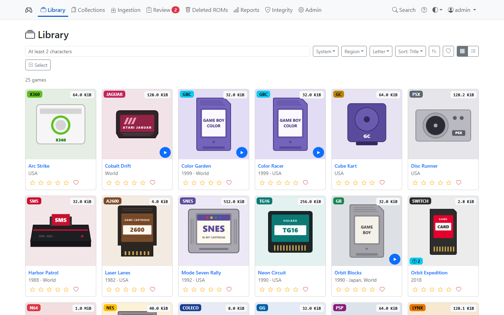
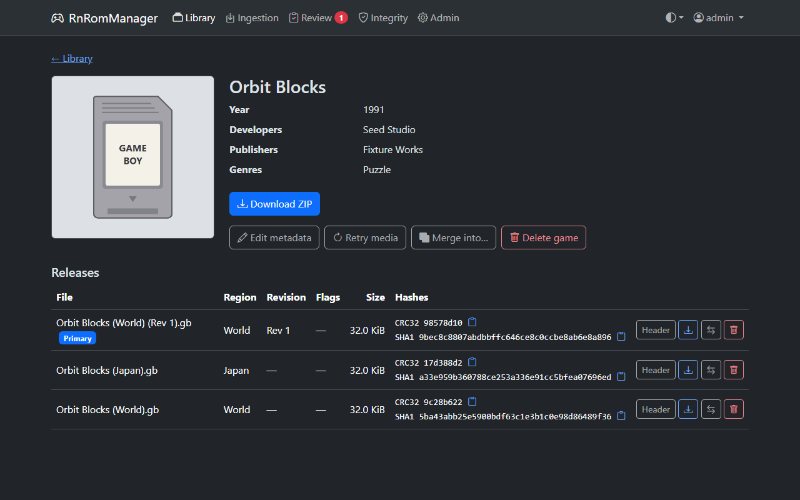
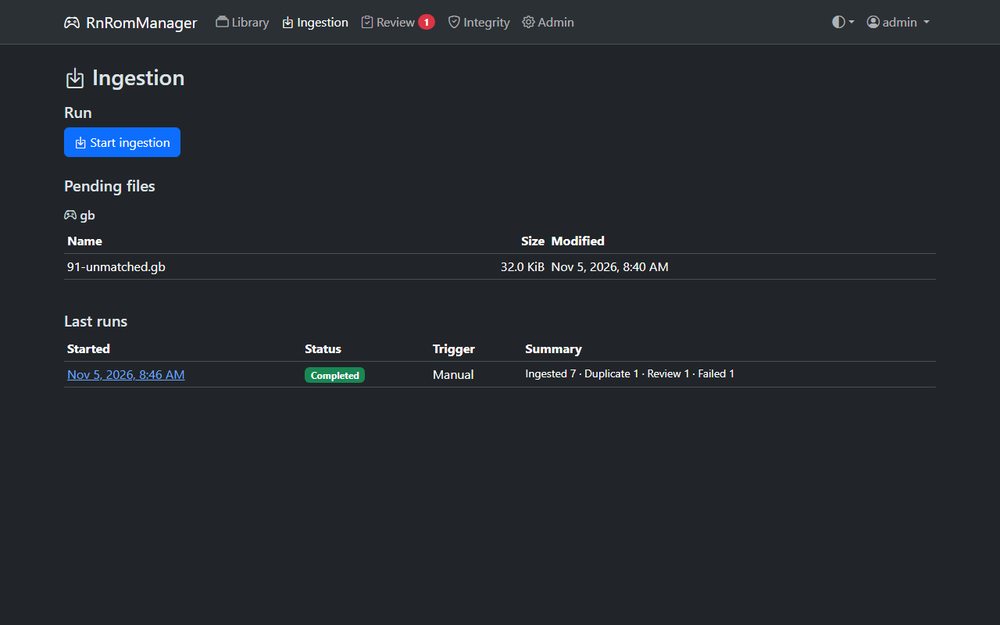

# RnRomManager

A self-hosted web app for managing a personal backup collection of **Game Boy**, **Game Boy Color** and **Game Boy Advance** ROMs.

Drop your own ROM files (or `.zip`/`.7z` archives of them) into an ingest folder. RnRomManager identifies each one against the [No-Intro](https://no-intro.org/) DATs, names it consistently, groups every region and revision of a game together, fetches box art and screenshots, and stores each game as one self-describing ZIP in a tidy `roms/<system>/<letter>/` layout. A MariaDB database mirrors the library for fast browsing, and a scheduled integrity checker keeps the two in sync.



- **Library:** grid or list, filter by system, region and letter, search, sort by title, year or date added; download a game's ZIP or a single ROM.
- **Ingestion:** identifies by hash, sorts dual-mode carts into Game Boy Color, files duplicates and broken files aside, and never deletes anything you'd want back.
- **Review queue:** files the DATs don't know get name suggestions, a DAT search, or manual entry.
- **Library edits (Admin):** edit metadata, move or merge releases between games, delete to a recoverable `_removed/` folder.
- **Integrity checks:** daily quick checks and on-demand deep (hash) checks, with automatic database repair.
- **Accounts:** Admins and read-only Users, light/dark theme, and it works on a phone.

| Game detail | Ingestion |
|---|---|
|  |  |

## Quick start

You need Docker with Compose. Create a folder with a `.env` file:

```dotenv
DB_PASSWORD=<a long random password>
ADMIN_PASSWORD=<at least 12 characters>
```

and a `docker-compose.yml`:

```yaml
services:
  rnrommanager:
    image: niemandr/rnrommanager:latest
    restart: unless-stopped
    ports: ["8080:8080"]
    environment:
      ConnectionStrings__Default: "Server=mariadb;Database=rnrommanager;User=rnrommanager;Password=${DB_PASSWORD}"
      Admin__InitialPassword: "${ADMIN_PASSWORD}"
      TZ: "Europe/London"
    volumes:
      - ./data/roms:/app/roms
      - ./data/ingest:/app/ingest
      - ./data/logs:/app/logs
      - ./data/cache:/app/cache
    user: "1000:1000"   # owner of ./data
    stop_grace_period: 35s   # lets a running job stop cleanly
    depends_on:
      mariadb: { condition: service_healthy }
  mariadb:
    image: mariadb:11.4
    restart: unless-stopped
    healthcheck:
      test: ["CMD", "healthcheck.sh", "--connect", "--innodb_initialized"]
      interval: 10s
      retries: 10
    environment:
      MARIADB_DATABASE: rnrommanager
      MARIADB_USER: rnrommanager
      MARIADB_PASSWORD: "${DB_PASSWORD}"
      MARIADB_RANDOM_ROOT_PASSWORD: "1"
    volumes: ["./data/db:/var/lib/mysql"]
```

Then:

```bash
mkdir -p data/{roms,ingest,logs,cache,db}
docker compose up -d
```

1. Open `http://<host>:8080`, sign in as `admin` with `ADMIN_PASSWORD`, and choose a new password.
2. **Admin → DATs → Refresh DATs** downloads the game databases (once, and whenever you want newer ones).
3. Copy your `.gb` / `.gbc` files into `data/ingest/gb/` and your `.gba` files into `data/ingest/gba/`, then press **Ingestion → Start ingestion**.

Upgrading from a version without Game Boy Advance? Run **Admin → DATs → Refresh DATs** once, or ingestion won't start (`DatsMissing`).

Set `user:` to the owner of `./data` (`id -u`:`id -g`). An existing MariaDB server, reverse proxies, backups, upgrades and password recovery are covered in the [deployment guide](https://github.com/rniemand/RnRomManager/blob/main/docs/deployment.md).

## Documentation

- [Deployment](https://github.com/rniemand/RnRomManager/blob/main/docs/deployment.md): compose, database, volumes, reverse proxy, backups, upgrades, password recovery
- [Configuration](https://github.com/rniemand/RnRomManager/blob/main/docs/configuration.md): every setting and its environment variable
- [Features](https://github.com/rniemand/RnRomManager/blob/main/docs/features.md): a guide to every page, plus the API behind it
- [ZIP format](https://github.com/rniemand/RnRomManager/blob/main/docs/zip-format.md): the library layout and `info.json`
- [Adding a system](https://github.com/rniemand/RnRomManager/blob/main/docs/adding-a-system.md): the `ISystemHandler` contract
- [Development](https://github.com/rniemand/RnRomManager/blob/main/docs/development.md) and [contributing](https://github.com/rniemand/RnRomManager/blob/main/CONTRIBUTING.md)

## Disclaimer

RnRomManager manages ROM files **you already own**, for personal backup. It does not download, include or distribute ROMs, and nothing in this project should be used to obtain games you don't own. Respect the copyright laws where you live.

## Attribution

- Game identification and metadata come from [libretro-database](https://github.com/libretro/libretro-database), licensed under [CC BY-SA 4.0](https://creativecommons.org/licenses/by-sa/4.0/).
- Box art and screenshots are downloaded from [libretro-thumbnails](https://github.com/libretro-thumbnails/libretro-thumbnails). They remain the copyright of their respective owners and are stored for personal use only.
- The placeholder cartridge box art is made for this project. Admin → About lists the licence of every dependency.

## License

[MIT](https://github.com/rniemand/RnRomManager/blob/main/LICENSE) © Richard Niemand
